# Generative AI-Assisted Interactive Movie Recommendation System

A team-built movie discovery application combining a Flask web interface, MongoDB storage, a **Truncated SVD + genre-preference recommender**, and a **Gemini-powered natural-language genre filter**.

The repository also contains separate **Neural Collaborative Filtering (NCF)** scripts and an **item-based KNN notebook** for offline experiments. These experimental models are not the models served by the Flask application.

> **Implementation status:** Local functional verification has been completed by the project maintainer, as reported on October 7, 2026, following configuration and input-validation fixes. This README combines inspected source files with those subsequently reported changes. The final edited source has not been independently re-inspected or rerun by the documentation reviewer. Cloud deployment and production readiness are not established.

## Contents

- [Features](#features)
- [Team](#team-and-contributions)
- [Architecture](#architecture)
- [Repository Layout](#repository-layout)
- [Included Data](#included-data)
- [Setup](#local-setup)
- [MongoDB Preparation](#mongodb-preparation)
- [Recommendation Logic](#personalized-recommendation-logic)
- [AI Assistant](#natural-language-ai-assistant)
- [Routes](#web-routes-and-api-endpoints)
- [Offline Experiments](#offline-model-experiments)
- [Evaluation Evidence](#evaluation-evidence-and-limitations)
- [Screenshots](#interface-screenshots)
- [Known Issues](#known-issues-and-required-fixes)
- [Verification](#manual-verification)
- [Security and Publication](#security-and-publication)

## Features

- Account registration and session-based login.
- Password hashing on registration and hash verification on login.
- Keyword search over movie titles.
- Personalized recommendations computed when a user logs in.
- Movie detail pages served as pre-generated static HTML.
- Movie ratings and favorite lists persisted in MongoDB.
- Click, rating, and favorite interactions recorded for recommendation inputs.
- A ranking page rendered from a pre-generated HTML template.
- Natural-language requests converted into wanted and banned movie genres.
- Local model caching with a three-day expiration policy, checked on login.

Caching avoids rebuilding a valid model at every login; no latency benchmark is included. Updates to ratings or favorites do not automatically invalidate the cache or immediately refresh the session's recommendations.

## Team and Contributions

Responsibilities below are retained from the original project documentation; they are not inferred from individual commit history.

| Member | Documented contribution |
|---|---|
| 謝秉諺 / Ping-Yen Hsieh | Backend/frontend integration, system deployment, database management |
| 劉家銘 / Chia-Ming Liu | Recommendation model design, generative AI integration, interface development |
| 杜昇峰 / Sheng-Feng Tu | Frontend UI/UX design, data preprocessing |

## Architecture

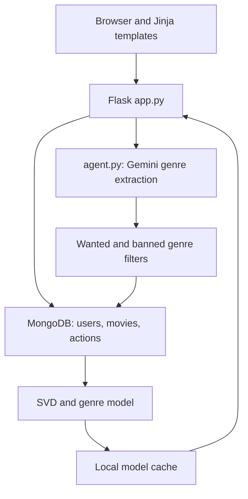

The two recommendation paths are separate:

1. **Personalized path:** MongoDB interactions → weighted user–movie matrix → Truncated SVD and genre preferences → candidate ranking → top 10.
2. **AI search path:** user prompt → Gemini genre classification → MongoDB genre filtering → sort by `avg_rating` → up to 10 movies.

`agent.py` is imported directly into Flask. The `AGENT_API_URL` constant in `app.py` is unused; there is no supplied standalone HTTP agent service to start on port 8000.

## Repository Layout

| Path | Purpose |
|---|---|
| `app.py` | Flask routes, authentication, MongoDB operations, SVD recommendation, cache management |
| `agent.py` | Gemini request and parsing of wanted/banned genre lists |
| `requirements.txt` | Dependencies for the main application |
| `.env.example` | Empty configuration template; copy to a local `.env` |
| `templates/` | Login, registration, search, results, favorites, rankings, and AI assistant views |
| `static/movie_pages/movie_pages.zip` | Archive of pre-generated movie detail HTML; extract before use |
| `movies.csv` | Filtered catalog and movie metadata |
| `useractions.csv` | Included rating interactions |
| `users.csv` | User IDs and demographic metadata; credentials are blank in this snapshot |
| `ncf.py` | NCF + genre weight experiment, metric calculation, CSV output |
| `ncf123.py` | NCF training/validation loss experiment and recommendation example |
| `KNN.ipynb` | Bias-corrected item-based KNN + genre experiment |
| `hybrid_ncf.csv` | Saved NCF experiment values, followed by non-tabular summary text |
| `figs/` | Previously generated evaluation and genre-distribution figures |
| `images/` | Interface screenshots |

The configuration includes `.env.example` and `.gitignore`. Keep the local `.env` private. `ratings.csv`, pre-trained model files, and the scripts used to generate the historical SVD baseline comparison figures are not included in the inspected source.

## Included Data

The original project identifies **MovieLens 1M** as the source dataset: [GroupLens MovieLens 1M](https://grouplens.org/datasets/movielens/1m/). The original dataset size is not the size of the filtered files shipped here. Full filtering and static-page generation scripts are not included, so the complete preprocessing pipeline cannot be reproduced from this repository alone.

### Snapshot Counts

| File | Rows | Fields |
|---|---:|---|
| `movies.csv` | 796 | `MovieID`, `Title`, `Genres`, `image`, `ratings` |
| `useractions.csv` | 230,054 | `UserID`, `Action_Type`, `MovieID`, `Rating` |
| `users.csv` | 6,040 | `UserID`, `Username`, `Email`, `Password`, `Gender`, `Age`, `Occupation` |

- The interaction file contains **6,042 distinct user IDs** and **796 distinct movie IDs**.
- All included interaction rows have `Action_Type = rate`. Clicks and favorites are supported by the web application, but are not present in this supplied CSV.
- `Username`, `Email`, and `Password` are blank in every included user row. These are not ready-to-use login accounts.
- The mismatch between 6,042 interaction users and 6,040 user metadata rows should be reconciled if complete user metadata is required. The SVD model itself trains from actions and movies, rather than requiring an account document for each historical user.
- `Genres` stores pipe-separated labels, such as `Action|Sci-Fi`.
- The catalog's `ratings` field is a movie-level score; the app's AI sorting expects `avg_rating`, so map or compute it explicitly during database setup.

Do not describe the delivered training data as a complete one-million-rating dataset. Preserve the original dataset's attribution and check its redistribution terms before publishing the CSV files.

## Local Setup

### Prerequisites

- A Python 3 environment with a mutually compatible set of the listed dependencies. This snapshot does not specify or verify an exact Python version.
- MongoDB, either a local instance or MongoDB Atlas, with permission to access the `Data` database.
- A Gemini API key authorized to use the model configured in `agent.py`.
- An internet connection for Gemini, Atlas if used, and externally hosted movie images.

### 1. Extract the Project and Create a Virtual Environment

Run commands from the directory containing `app.py` and the CSV files.

```bash
python -m venv .venv
```

Windows PowerShell:

```powershell
.\.venv\Scripts\Activate.ps1
```

macOS/Linux:

```bash
source .venv/bin/activate
```

Install the main application dependencies:

```bash
python -m pip install -r requirements.txt
```

The supplied requirements are `Flask`, `pymongo[srv]`, `pandas`, `numpy`, `scikit-learn`, `google-genai`, and `python-dotenv`. Versions are not pinned. After verifying a working environment, record its dependency versions for reproducibility.

### 2. Configure Environment Variables

Copy `.env.example` to `.env` and fill in your own credentials.

Windows PowerShell:

```powershell
Copy-Item .env.example .env
```

macOS/Linux:

```bash
cp .env.example .env
```

```dotenv
FLASK_SECRET_KEY=replace-with-a-random-secret
MONGODB_URI=replace-with-your-mongodb-connection-string
GEMINI_API_KEY=replace-with-your-new-api-key
```

Generate a session secret locally:

```bash
python -c "import secrets; print(secrets.token_hex(32))"
```

Do not commit `.env`. Both Python modules call `load_dotenv()` and access required settings using `os.environ[...]`; missing settings produce `KeyError`. Gemini initialization occurs during app import, so the key is required at startup even before opening the assistant page.

### 3. Confirm the Database Configuration

The application uses the following database and collection configuration:

```python
client = MongoClient(os.environ["MONGODB_URI"])
db = client["Data"]
collection = db["Users"]
movies_collection = db["Movies"]
actions_collection = db["UserActions"]
```

### 4. Extract Movie Detail Pages

The nested ZIP already contains a `movie_pages/` directory. Extract it into **`static/`**, rather than into `static/movie_pages/`, to avoid an extra nested directory.

```bash
python -m zipfile -e static/movie_pages/movie_pages.zip static
```

Verify paths such as `static/movie_pages/100.html` exist. The `/movie/<movie_id>` route redirects to these files; Flask does not extract the archive automatically.

### 5. Prepare MongoDB

Follow the next section, then start the application:

```bash
python app.py
```

Open [http://127.0.0.1:5000/login](http://127.0.0.1:5000/login) and register a new account. `debug=False` is configured. This starts Flask's development server, not a production hosting setup.

## MongoDB Preparation

### Collections and Field Names

MongoDB field names are case-sensitive. Historical CSV headers and newly registered account fields differ.

| Collection | Fields used by the application |
|---|---|
| `Data.Users` | `UserID` (integer), `username`, `email`, `password` (hash), `gender`, `age`, `occupation` |
| `Data.Movies` | `MovieID` (integer), `Title`, `Genres`, `image`, `avg_rating`; fallback uses `avg_rating` |
| `Data.UserActions` | `UserID` (integer), `MovieID` (integer), `Action_Type`, `Rating` for rating records, `Favorite` for favorite records |

Registration allocates `UserID` using the current maximum in `Users`. If only historical actions are imported and `Users` is empty, new accounts start at ID 1 and may inherit a historical user's interactions. Seed historical user IDs or implement an allocator that accounts for both collections before registering accounts.

### Suggested One-Time CSV Import

The following is a **setup example provided by this README**, not a script already included in the source. Save it locally as `seed_database.py` if needed. It keeps IDs numeric, seeds placeholder historical users, maps the catalog score to `avg_rating`, and imports the bundled rating interactions.

**Run once against a new, dedicated database.** Re-running it duplicates user/action records. Back up an existing database before choosing a migration strategy. The sample preserves imported `ratings` and maps it to `avg_rating`, which both AI result sorting and the fallback recommender use.

```python
import os
import pandas as pd
from dotenv import load_dotenv
from pymongo import MongoClient

load_dotenv()
db = MongoClient(os.environ["MONGODB_URI"])["Data"]

if any(db[name].count_documents({}) for name in ("Users", "Movies", "UserActions")):
    raise RuntimeError("Use an empty database or write an explicit migration.")

movies = pd.read_csv("movies.csv")
movies["MovieID"] = movies["MovieID"].astype(int)
movies["avg_rating"] = pd.to_numeric(movies["ratings"], errors="coerce").fillna(0)
movie_docs = movies.astype(object).where(movies.notna(), None).to_dict("records")
if movie_docs:
    db.Movies.insert_many(movie_docs)

actions = pd.read_csv("useractions.csv")
for column in ("UserID", "MovieID"):
    actions[column] = actions[column].astype(int)
action_docs = actions.astype(object).where(actions.notna(), None).to_dict("records")
if action_docs:
    db.UserActions.insert_many(action_docs)

users = pd.read_csv("users.csv")
metadata = {
    int(row["UserID"]): row
    for row in users.astype(object).where(users.notna(), None).to_dict("records")
}
all_ids = sorted(set(metadata) | set(actions["UserID"].tolist()))
user_docs = []
for uid in all_ids:
    row = metadata.get(uid, {})
    user_docs.append({
        "UserID": int(uid),
        "gender": row.get("Gender"),
        "age": row.get("Age"),
        "occupation": row.get("Occupation"),
    })
if user_docs:
    db.Users.insert_many(user_docs)

print("Imported historical data. Register new accounts through the web interface.")
```

The placeholders deliberately have no login credentials. Do not fill them with shared passwords. Existing accounts using plaintext passwords require a separate password reset or controlled hash migration.

Indexes on `Movies.MovieID`, `Users.UserID`, and `UserActions.(UserID, MovieID, Action_Type)` can support queries. If adding unique username/email indexes, use an appropriate partial index so historical placeholder documents without those fields do not conflict. Concurrent registration still needs an atomic ID allocation strategy; an index alone does not fix it.

## Personalized Recommendation Logic

### Interaction Weights

`build_recommender_with_genre()` loads MongoDB actions and movies, converts each action to a preference value, and sums values for each user–movie pair.

| Signal | Application preference value |
|---|---:|
| Rating 1 | 0.5 |
| Rating 2 | 1.0 |
| Rating 3 | 3.0 |
| Rating 4 | 4.0 |
| Rating 5 | 5.0 |
| `click` without a rating | 2.0 |
| `addtofav` | 4.0 |

A favorite takes priority over a rating on the same record. Other numeric ratings fall back to their numeric value. Repeated clicks accumulate, and a summed preference may exceed 5; these are preference scores rather than guaranteed calibrated rating predictions.

### SVD and Genre Ranking

1. Pivot aggregate preferences into a user–movie matrix.
2. Compute each user's mean over observed preferences.
3. Subtract user means and fill missing centered values with zero.
4. Fit `TruncatedSVD` with `random_state=42` and up to 20 components.
5. Reconstruct scores and add user means back.
6. Build normalized genre preferences from weighted interaction totals.
7. Exclude previously interacted movies.
8. Rank candidates using the application defaults:

```text
final_score = 0.7 × SVD_score + 0.3 × genre_bonus
```

`genre_bonus` sums the user's preference weights for all genres of a candidate. It is not multiplied by 5 in the web application. The historical README's `0.9/0.1` configuration is not the current application default.

For new users or an unavailable model, `recommend_movies()` sorts catalog documents by numeric `avg_rating`. The separate `get_top_movies_fallback()` function aggregates average ratings, but is not called by this main fallback path.

### Cache Lifecycle

- Cache path: `recommender_cache.pkl` in the working directory.
- Contents: score matrix, user/movie IDs, means, genre preferences, aggregate interactions, and timestamp.
- Checked after successful login; missing or older-than-three-day cache triggers rebuilding.
- Expiration is checked on login, not by a background schedule.
- No immediate refresh occurs after rating/favorite updates.
- Model state is stored in process globals, so multi-worker consistency is not implemented.
- Only load trusted, locally generated pickle files.

## Natural-Language AI Assistant

`generate_movie_genres()` requests a JSON object from **`gemini-2.5-flash`**:

```json
{"wanted": ["Action", "Sci-Fi"], "banned": ["Horror"]}
```

Allowed labels in the prompt are Action, Adventure, Animation, Children's, Comedy, Crime, Documentary, Drama, Fantasy, Film-Noir, Horror, Musical, Mystery, Romance, Sci-Fi, Thriller, War, and Western.

The Flask route includes movies matching **any wanted genre** and excludes movies matching **any banned genre**. Results are sorted by `avg_rating`, with up to 10 returned. An exclusion-only request is supported by the query logic.

This is genre-based catalog retrieval, not embedding search, movie-title generation, a conversational RAG pipeline, or the personalized SVD ranking path. There is no fixed guarantee of three genres or exactly ten results.

Current limitations:

- JSON parsing handles raw JSON and a particular fenced JSON format. Downstream genre-list validation is implemented; validation of the complete top-level Gemini response schema can still be strengthened.
- Genre filtering validates list entries against canonical allowed labels, preserves punctuation in `Children's`, ignores invalid entries, and removes duplicates. These changes were reported by the maintainer after the last source inspection.
- Gemini API errors, timeouts, and unexpected response types are not fully handled.
- Prompts are sent to Gemini and written to local `assistant.log`; avoid sensitive input and define retention before deployment.
- Requested genres can yield fewer than ten or no matching movies.

## Web Routes and API Endpoints

| Method | Route | Behavior |
|---|---|---|
| GET / POST | `/register` | Registration page and hashed-password account creation |
| GET / POST | `/login` | Authenticate, load/rebuild model, populate session recommendations |
| GET | `/logout` | Remove username from session and redirect to login |
| GET | `/search` | Search page and stored recommendation IDs |
| GET | `/results?keyword=...` | Case-insensitive MongoDB regex title search |
| GET | `/movie/<movie_id>` | Record click and redirect to static HTML |
| GET | `/api/check_favorite/<movie_id>` | Return favorite status as JSON |
| POST | `/rate` | Validate a positive integer movie ID and integer rating 1–5; check movie existence; upsert rating |
| POST | `/favorite` | Validate a positive integer movie ID and JSON boolean; check movie existence; add/remove favorite |
| GET | `/favorites` | Retrieve the logged-in user's favorite movies |
| GET | `/rankings` | Render pre-generated ranking template |
| GET | `/assistant` | Natural-language request form |
| POST | `/assistant/recommend` | Parse form prompt, filter catalog, return ranked results |

Example rating request body:

```json
{"movie_id": 100, "rating": 4}
```

Example favorite request body:

```json
{"movie_id": 100, "favorite": true}
```

The main views require login. `/api/check_favorite/...` returns `false` when logged out. The static detail HTML files themselves are publicly served by Flask without the authentication check in `/movie/...`. There is no supplied route for `/`; open `/login` directly.

## Offline Model Experiments

Install additional packages only when running the experiments:

```bash
python -m pip install torch tqdm matplotlib jupyter
```

Choose a PyTorch build suitable for your hardware; the scripts automatically select CUDA if available, otherwise CPU. Run from the project root so relative CSV paths resolve.

### `ncf123.py`: NCF Training Example

```bash
python ncf123.py
```

- Reads `useractions.csv` and `movies.csv`; exits if either is absent.
- User/item embeddings of size 32; hidden layers 64 and 32 with ReLU and dropout 0.2.
- MSE objective, Adam optimizer, learning rate 0.001, weight decay `1e-5`.
- Batch size 256; 30 epochs; random 80/20 interaction split with `random_state=42`.
- Plots training/validation MSE and prints an example top-five recommendation.
- No trained checkpoint is saved or connected to Flask.

### `ncf.py`: NCF + Genre Weight Sweep

```bash
python ncf.py
```

- Tests genre weights β = 0, 0.1, 0.2, 0.3, 0.4, 0.5, with α = 1 − β.
- Trains a fresh NCF model for each weight for 20 epochs.
- Scores validation interactions using `α × NCF_score + β × genre_score × 5`.
- Writes `hybrid_experiment_results.csv`; deletes that output file if it already exists.
- Reports RMSE, MAE, thresholded precision/recall at preference 3.5, and mean per-user nDCG on validation interactions.
- If the input CSVs are missing, silently switches to generated mock data after printing a warning. Confirm real input files exist before interpreting results.

The scripts use `add_to_favorite` and `view`, whereas Flask writes `addtofav` and `click`. Harmonize action names before comparing experiments on newly collected web interactions.

### `KNN.ipynb`: Bias-Corrected Item-Based KNN

```bash
jupyter notebook KNN.ipynb
```

- Requires `ratings.csv`, which is not included. Provide real rating records with `UserID`, `MovieID`, and `Rating`; do not rename arbitrary interaction data without validating its meaning.
- Holds out approximately 20% of each sufficiently active user's observed ratings; users with fewer than five ratings are skipped for holdout.
- Computes global/user/item bias terms, residual-based item similarity, and weighted-neighbor predictions.
- Tests 10 and 20 neighbors and genre weights from 0 to 0.5.
- Uses TF-IDF-inspired genre weights and aligns genre scores to the KNN score distribution.
- Reports RMSE, MAE, Precision@10, Recall@10, and nDCG@10, with relevant held-out ratings defined as at least 3.
- Does not set a random seed for the PyTorch holdout; runs may differ.

## Evaluation Evidence and Limitations

### Saved NCF Artifact

`hybrid_ncf.csv` contains **120 complete metric rows** (six weights × twenty epochs), followed by non-CSV summary text. It is not a clean table from top to bottom. The file's schema resembles the `ncf.py` output, but the current script writes a different filename. Its exact generation provenance is not independently established.

The lowest recorded RMSE among its complete rows is:

| β | α | Epoch | RMSE | MAE | Precision | Recall | nDCG |
|---:|---:|---:|---:|---:|---:|---:|---:|
| 0.0 | 1.0 | 12 | 1.1137 | 0.8581 | 0.7608 | 0.7242 | 0.9579 |

This is a **saved historical result**, not a fresh rerun. Precision and recall here are thresholded classification metrics, **not Precision@10 or Recall@10**. `ncf.py` calls `ndcg_score` without `k`, over each user's observed validation subset, rather than ranking the whole unseen catalog.

To read only complete metric rows:

```python
import pandas as pd

results = pd.read_csv("hybrid_ncf.csv")
columns = ["Beta", "Alpha", "Epoch", "RMSE", "MAE", "Precision", "Recall", "nDCG"]
for column in columns:
    results[column] = pd.to_numeric(results[column], errors="coerce")
results = results.dropna(subset=columns)
```

### Historical SVD Comparison

The original README reported the following figures, retained here as **unverified historical documentation**:

| Model | RMSE | MAE | Precision@10 | Recall@10 | nDCG@10 |
|---|---:|---:|---:|---:|---:|
| Pure SVD | 0.8097 | 0.5956 | 0.0382 | 0.3820 | 0.2994 |
| Genre-only | 1.7060 | 1.3650 | 0.0246 | 0.2461 | 0.1354 |
| Random | 1.7590 | 1.4386 | 0.0016 | 0.0160 | 0.0071 |
| SVD + genre, α = 0.9, β = 0.1 | 0.9062 | 0.7358 | 0.0400 | 0.4003 | 0.3058 |

The baseline evaluation scripts and claimed model pickle files are absent from the supplied ZIP. These values therefore cannot be regenerated from the available files and should not be presented as newly verified performance. The application uses a different default weighting. The small historical nDCG difference does not establish statistical significance, causal effects, or higher user satisfaction.

### Methodological Limits

- `ncf.py` calculates genre profiles from the full interaction data **before** splitting train/validation; validation preferences leak into the genre feature used at evaluation.
- Each weight uses a separately initialized/trained model, and PyTorch/NumPy randomness is not fully seeded. Weight comparisons therefore also reflect training variation.
- Different experiment files use different candidate sets, relevance thresholds, score scales, and metric definitions. Their nDCG and precision/recall values are not directly comparable.
- The web model trains on available interactions without an evaluation split; its online recommendation logic does not establish held-out predictive performance.
- No confidence intervals, repeated-seed study, online A/B test, throughput test, or causal analysis is included.

For a reproducible benchmark, split data before deriving user features; use the same held-out users/items and candidate protocol across baselines; set all random seeds; retain clean outputs and model configurations; report error and ranking metrics separately.

### Included Figures

These are historical artifacts; their generation scripts are not included. Treat them as visual documentation rather than proof of a newly reproduced comparison.

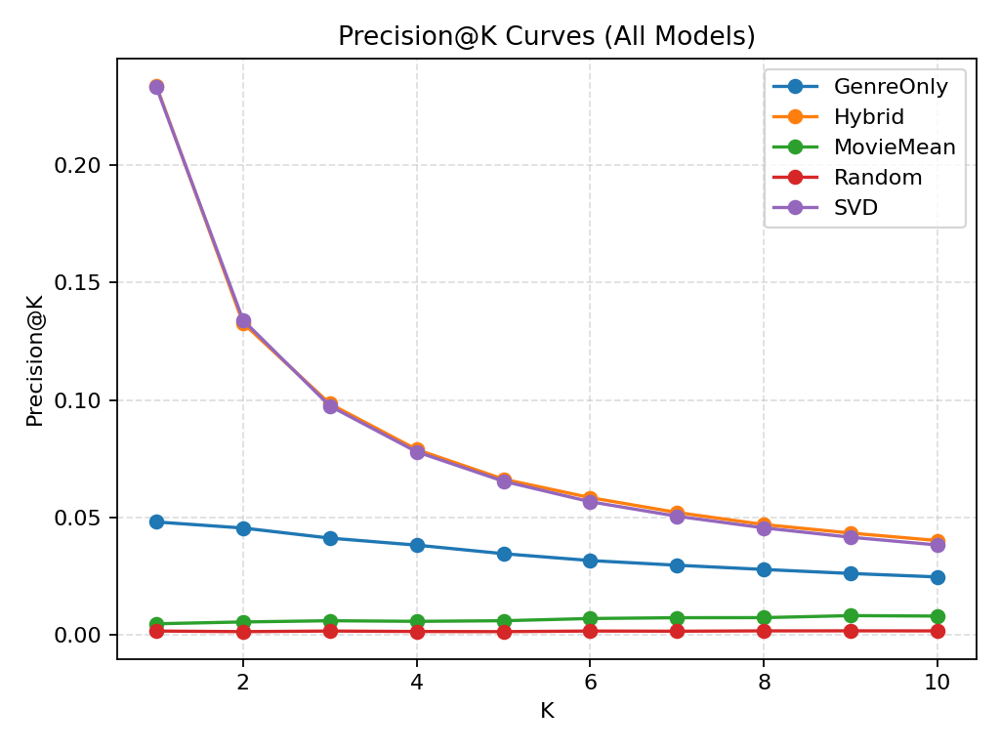
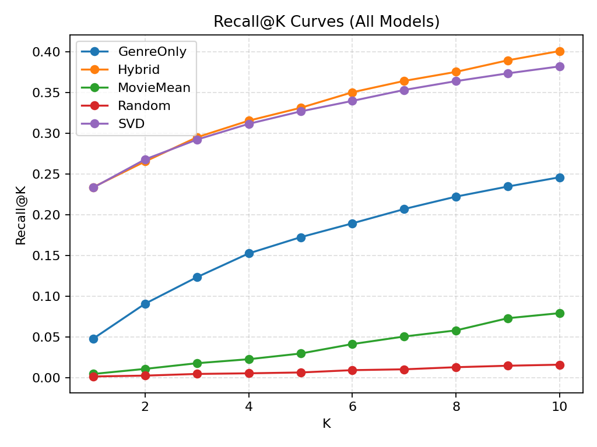
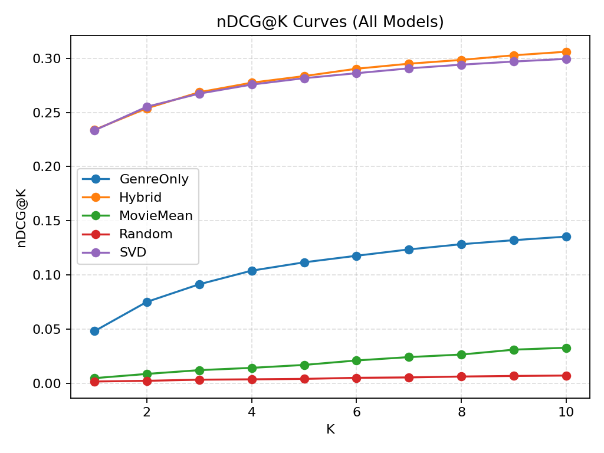
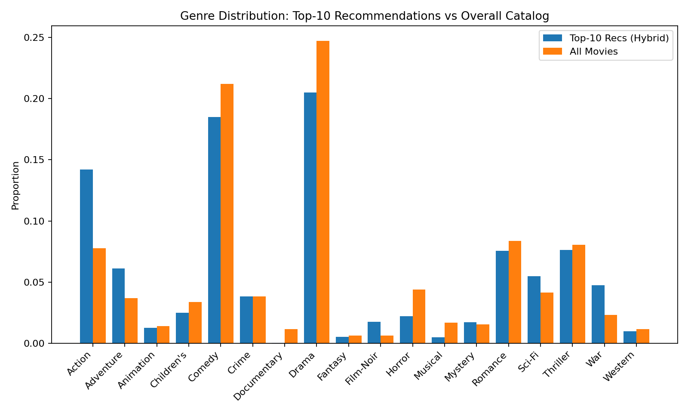

A genre-distribution plot alone cannot confirm individualized recommendation quality or infer causal effects.

## Interface Screenshots

Screenshots document the prior interface and do not verify that the current snapshot has been run successfully.

| Search | Movie detail |
|---|---|
| 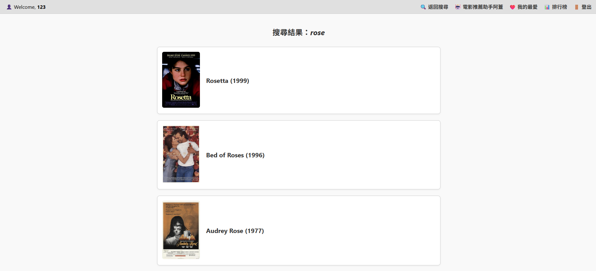 | 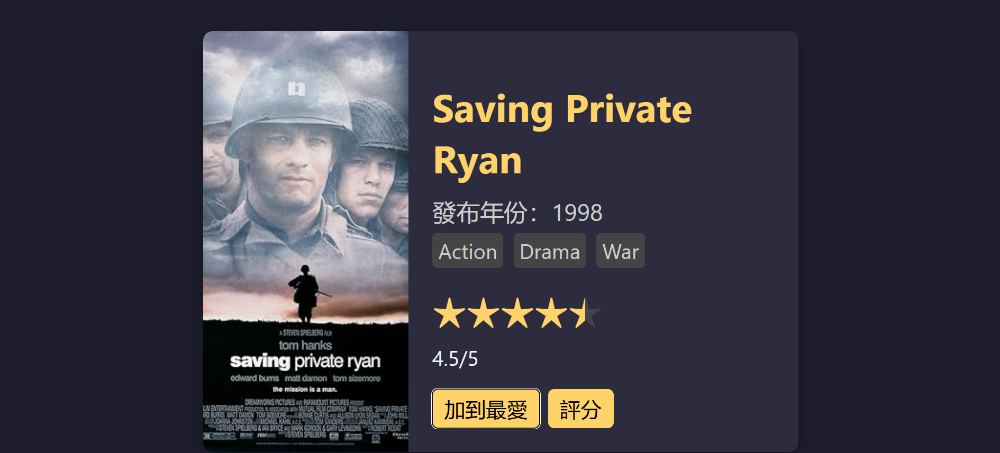 |

| Recommendations | Favorites |
|---|---|
| 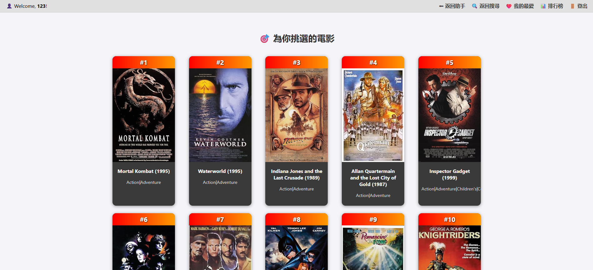 | 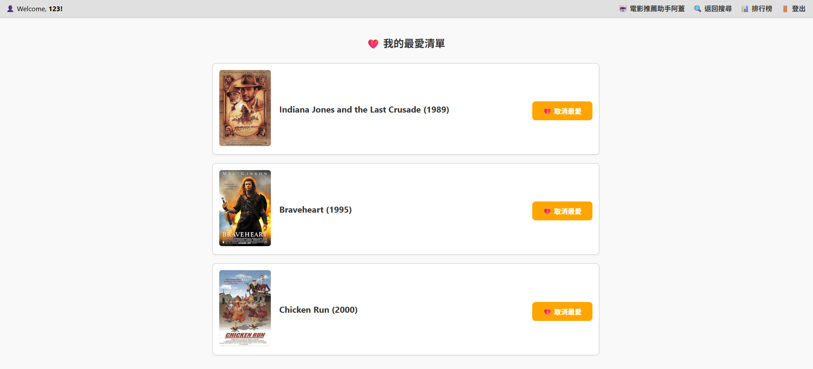 |

| AI assistant | Rating |
|---|---|
| 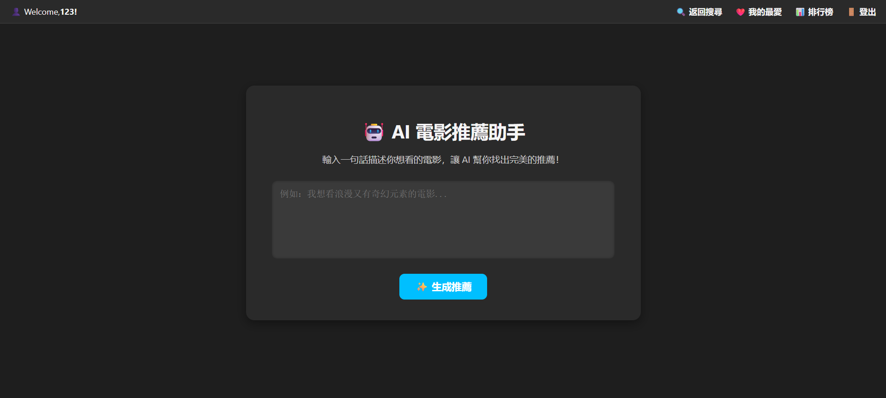 | 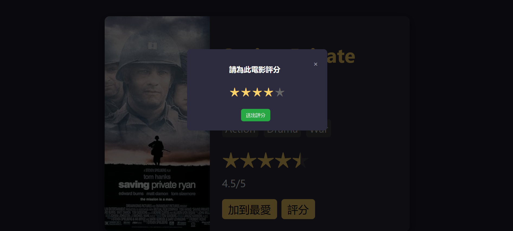 |

| Ranking page | Personalized search |
|---|---|
| 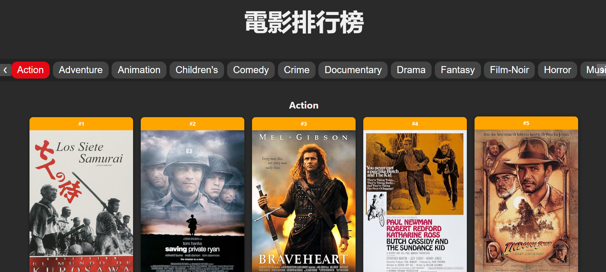 | 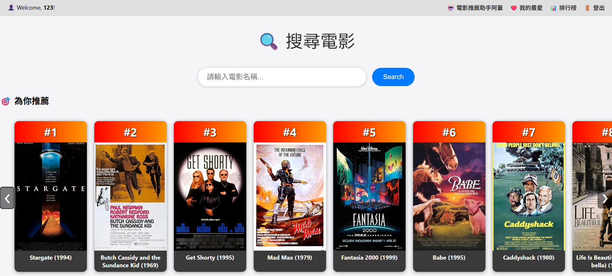 |

## Known Issues and Required Fixes

### Completed Fixes

The database definition, password whitespace handling, SVD size guard, configuration filenames, ignore rules, and fallback sort update were inspected in uploaded source. Movie-page extraction, MongoDB `avg_rating` confirmation, canonical genre validation, and rating/favorite request validation were subsequently reported complete by the maintainer.

| Area | Current documented behavior |
|---|---|
| Startup | `db = client["Data"]` is defined before collection access |
| Configuration | `.env.example` supplies empty settings; `.env` is ignored |
| Authentication | Registration hashes passwords; login verifies hashes without stripping password whitespace |
| Movie pages | Static detail pages have been extracted, as reported by the maintainer |
| Model | A matrix dimension below 2 returns to the fallback path before SVD fitting |
| Ranking | Fallback and AI sorting use numeric `avg_rating`; database field confirmed by maintainer |
| Genre filters | Canonical-label validation preserves `Children's` and removes duplicates |
| Rating API | Requires an integer rating from 1 to 5 and an existing movie |
| Favorite API | Requires a JSON boolean and an existing movie |
| Request handling | Rating/favorite endpoints reject malformed or non-object JSON |

### Remaining Limitations

- Historical actions contain more distinct user IDs than the metadata file; maintain consistent IDs during import and new-account allocation.
- Concurrent registration requires an atomic ID allocation strategy.
- Gemini service failures, timeouts, and unexpected response schemas need stronger handling.
- Model cache and session recommendations do not refresh immediately after interaction updates.
- `ratings.csv` is still required for KNN; the saved NCF artifact contains non-tabular footer text.
- Offline evaluation limitations described above remain; functional verification does not reproduce model performance claims.

Recommended `.gitignore`:

```gitignore
.env
.env.*
!.env.example
.venv/
venv/
__pycache__/
*.py[cod]
*.pkl
*.pickle
*.log
.ipynb_checkpoints/
```

Further deployment work includes CSRF protection, atomic account IDs, rate limiting, robust request/API error handling, consistent cache invalidation, concurrency-safe model state, secure cookie configuration, and a production WSGI deployment. These are not claimed as implemented.

## Manual Verification

The maintainer reports completing local verification on October 7, 2026. The following checklist documents the expected behavior and can be used for future regression checks; no individual test logs were supplied:

1. Start with all required environment variables set; confirm `/login` renders.
2. Register a new account; inspect that the stored `password` is a hash, not the submitted plaintext.
3. Verify correct login succeeds and incorrect login fails; test password whitespace consistently.
4. Confirm a new account does not reuse historical interaction IDs and receives a valid fallback list.
5. Search for a known movie, open its detail page, and verify the click action is recorded.
6. Submit a rating, change it, and verify the same rating action is updated.
7. Add and remove a favorite; verify both the page and API status.
8. Log in with missing/expired cache; confirm model building and cache generation. Then confirm a valid cache is loaded.
9. Test an AI request with wanted genres, an exclusion, and an empty prompt. Verify ordering uses numeric `avg_rating`.
10. Test database/API failures and invalid input before allowing public use.

Uploaded Python files passed syntax parsing. Subsequent local functional verification was reported by the maintainer; it was not independently executed by the documentation reviewer. Performance measurements and production deployment validation remain separate work.

## Security and Publication

- Earlier project versions contained a Gemini API key and MongoDB credentials. Revoke the old Gemini key and rotate the database password; removing strings from source does not invalidate them.
- The reviewed ZIP uses environment variables and contains no detected instances of the previously identified hardcoded credential patterns. This is a scoped scan, not a guarantee that every binary asset or remote history is free of secrets.
- Publish a new clean working tree without importing the old Git history. Keep `.env`, logs, untrusted pickle files, and personal records out of commits.
- Password hashing is implemented, but old plaintext accounts need reset/migration.
- Do not load pickle files received from untrusted sources.
- Preserve collaborator attribution. Check permissions for data, screenshots, poster images, and pre-generated movie pages before redistribution.
- No project `LICENSE` file is included. Confirm ownership and team agreement before adding a software license; dataset and third-party asset terms remain separate.

## Scope of This Documentation Update

This README was written from the supplied application code, experiment scripts/notebook, CSV files, templates, archived page structure, screenshot/figure filenames, and original documentation. It distinguishes implemented behavior, historical evidence, setup examples, and proposed fixes. Later fixes and successful local verification are documented from maintainer reports. This update changes documentation only; the final local source and verification logs were not supplied for independent confirmation.
